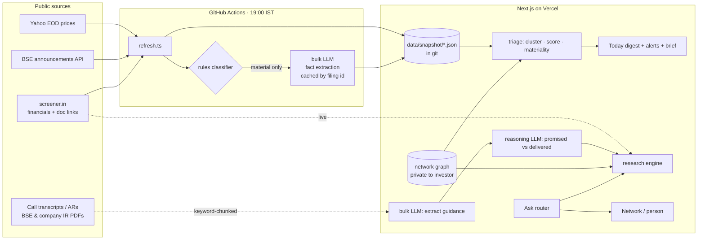

# FINN — what changed, why it matters, who can help

A mobile-first investment agent for a public-markets investor. One feed that tells you what matters across your holdings (Push), one box to research anything on primary sources (Pull), and your own network woven through both.

**Try it on a phone.** Add it to your home screen: it installs as a PWA.

## A 3-minute demo path

1. **Today → tap "30 days".** 72 real filings across 15 holdings become 11 stories. 39 routine filings are folded away.
   - *Persistent raised ₹11,865 cr in 10 days.* FINN links three separate filings (QIP, NCDs, CP) to the Nagarro acquisition costs in the same quarter's results. It also flags that ~12% of market cap was raised. Who to call: the ex-Nagarro engineering head in your network.
   - *HDFC Bank: Anup Bagchi, MD & CEO.* Bio, career and education come from public reporting. Your way in: Aditi Joshi, who worked at ICICI Bank during his six years as ED.
   - *PI Industries: profit −70% YoY.* A first-cut QoQ/YoY table of Revenue, EBITDA, PBT and PAT, with margin change in bps and an other-income flag.
   - *SRF: ₹12.77 lakh GST penalty.* Demoted as immaterial (0.0007% of revenue). That's the filter working.
2. **Tap "▶ Brief"** for a 60-second spoken briefing, which works on the phone's own speech engine.
3. **The sliders icon.** Choose what interrupts you: price move %, volume multiple, and alert / digest / hide per filing type.
4. **Ask → "Did Persistent deliver on its promises?"** shows the promised-vs-delivered ledger with verbatim quotes from four calls: the $2B revenue target is at risk, the +200–300 bps margin target is slipping, and the wage-hike bridge was delivered. Below it, how the language shifted, then narrative vs numbers, cash quality and bull/bear.
5. **Ask → "HAVELLS"** (or any NSE symbol) runs live research from screener.in plus the last four transcripts. Needs `GEMINI_API_KEY` for the transcript step.
6. **Network.** "You know someone who has worked inside 14 of your 15 holdings." See the orbit of relationships, coverage per holding, paths to people in the news, reasons to reconnect, and go-to people by theme.
7. **Any person → "Draft a note"** opens WhatsApp with a reconnect message tied to the news.

## Run locally

```bash
npm install
npm run dev            # http://localhost:3000
npm run refresh        # pull fresh prices, BSE filings, fundamentals into data/snapshot/
```

Copy `.env.example` to `.env.local` and add a free [Gemini API key](https://aistudio.google.com/apikey) to enable live transcript analysis and fact extraction. Everything else runs without a key.

## Deploy (free tier)

1. Push this repo to GitHub, then **Import** it on [vercel.com](https://vercel.com/new) (zero config). Add `GEMINI_API_KEY` under Environment Variables.
2. In GitHub → Settings → Secrets → Actions, add `GEMINI_API_KEY`. In Actions, run **Evening refresh** once by hand. After that it runs at 19:00 IST on weekdays, commits `data/snapshot/`, and Vercel redeploys.

## Architecture



| Folder | What lives there |
|---|---|
| `lib/triage.ts` | Push engine: cluster related filings, score materiality against company size, write the take, attach people |
| `lib/network.ts` | Graph logic: career/education overlaps, 2nd-degree paths, who-to-call ranking, coverage, reconnect triggers |
| `lib/research.ts` | Pull engine: deterministic numbers → transcript extraction (bulk model) → synthesis (reasoning model) |
| `lib/screener.ts`, `lib/bse.ts`, `lib/prices.ts` | Data adapters, shared by the cron job and the live API |
| `lib/llm.ts` | Two-tier model router with fallbacks, content-hash cache and cost accounting |
| `data/seed/` | Curated snapshot (real data, 13–14 Nov 2026) so the app runs before the first refresh; synthetic network |
| `scripts/refresh.ts` | Evening pipeline |

## Data honesty

- **Real:** prices and market caps, quarterly and annual financials (screener.in), ~70 exchange filings for 21 Oct – 14 Nov 2026 with their BSE PDF links, Persistent's guidance quotes (its own transcripts), and executives' public career facts (cited; `c.` marks approximate years).
- **Synthetic:** every contact in the investor's network (names, careers, relationship strength). They are fictional people designed to overlap with the portfolio.
- Exchange timestamps weren't available in the seed listing, so seed filings default to 18:30 IST. The BSE feed provides exact times.
